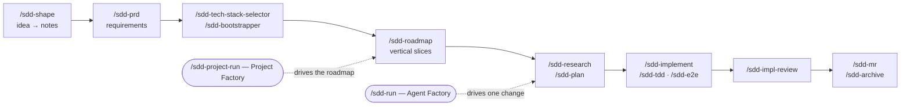

# sdd-toolkit — Spec-Driven Development for Claude Code, Codex & Cursor

[](LICENSE)
[](https://github.com/norbertsuski/sdd-toolkit/actions/workflows/validate.yml)


**Turn an idea into a PRD, a roadmap, a phased plan and verified, reviewed code — with AI coding agents that follow the spec instead of drifting from it.**

AI coding agents write code fast, but on anything bigger than a single prompt they lose the thread: requirements get guessed, plans live only in chat history, and nobody checks the result against what was asked. **sdd-toolkit** is a Claude Code plugin (also usable as native Agent Skills in OpenAI Codex and Cursor) that makes the spec the source of truth. Every step writes a plain Markdown artifact into a `context/` folder in your repo, and the next step reads it. Requirements, decisions and progress survive across sessions, agents and teammates.

- **28 `/sdd-*` skills** covering the full lifecycle: discovery → PRD → tech stack → roadmap → research → plan → implement (TDD / E2E) → review → merge request → archive.
- **Greenfield and brownfield.** Start from an idea, or assess and evolve an existing codebase (stack assessment, health check, test rollout).
- **Agent Factory (`/sdd-run`).** Drives one change end-to-end: routes missing preparation, picks single-agent vs. multi-agent execution, sizes model/effort per phase, verifies independently, and resumes after interruption.
- **Project Factory (`/sdd-project-run`).** Drives a whole roadmap, one change at a time, with replanning and an append-only project log.
- **Human gates stay in.** Attended runs pause for your decisions; unattended runs stop honestly instead of guessing.



## Contents

- [Quickstart](#quickstart)
- [Install](#install) · [Update](#update) · [Local testing](#local-testing-no-install) · [Install for Cursor](#install-for-cursor) · [Install for Codex](#install-for-codex)
- [The SDD skills](#the-sdd-skills)
- [The Agent Factory (`/sdd-run`)](#the-agent-factory-sdd-run)
- [The Project Factory (`/sdd-project-run`)](#the-project-factory-sdd-project-run)
- [Notes](#notes) · [License](#license)

## Quickstart

In Claude Code (using Codex or Cursor? see [Install for Codex](#install-for-codex) / [Install for Cursor](#install-for-cursor), and type `$sdd-…` instead of `/sdd-…` in Codex):

```
/plugin marketplace add https://github.com/norbertsuski/sdd-toolkit.git
/plugin install sdd-skills@sdd-toolkit
```

Then, in any project:

```
/sdd-help                       # the map: which skill to run, in what order
/sdd-init                       # create the context/ folder for SDD artifacts
/sdd-shape                      # talk an idea (or a brownfield change) into shape-notes
/sdd-prd                        # turn the notes into a PRD
/sdd-roadmap                    # split the PRD into dependency-ordered slices
/sdd-project-run                # or let the Project Factory drive it from here
```

Unsure where you are? `/sdd-help <project>` reports the current stage and the single next command.

This repo is a Claude Code plugin marketplace. It currently ships one plugin, **sdd-skills**: the spec-driven development (SDD) skill family (28 `sdd-*` skills), including two orchestration layers, the `/sdd-run` Agent Factory (one change) and the `/sdd-project-run` Project Factory (a whole project).

## Install

```
/plugin marketplace add https://github.com/norbertsuski/sdd-toolkit.git
/plugin install sdd-skills@sdd-toolkit
```

## Update

```
# after pushing changes (and bumping "version" in .claude-plugin/plugin.json)
/plugin marketplace update
/plugin update
```

## Local testing (no install)

Run Claude Code in any project with this repo as a plugin dir:

```
claude --plugin-dir /path/to/sdd-toolkit
```

## Install for Cursor

Cursor has native [Skills](https://cursor.com/docs/skills) that use the **same
`SKILL.md` format** as Claude Code (same `name` / `description` frontmatter, same
`references/` bundling, automatic or manual activation). So there's no conversion —
you just copy the skill folders into a Cursor skills directory:

- **Per project:** `.cursor/skills/` in the target repo
- **All projects:** `~/.cursor/skills/` (global)

Copy the whole `sdd-*` folders (so each keeps its `references/` subfolder and the
cross-skill relative links like `../sdd-shape/references/context-resolution.md`
still resolve — Cursor discovers skills recursively):

```
# global (all projects)
mkdir -p ~/.cursor/skills
cp -R /path/to/sdd-toolkit/skills/sdd-* ~/.cursor/skills/

# or per project
mkdir -p .cursor/skills
cp -R /path/to/sdd-toolkit/skills/sdd-* .cursor/skills/
```

That's it — Cursor picks them up on the next start. Invoke a skill by typing `/`
in Agent chat and picking it, or let the agent auto-select based on the skill's
`description`.

Prefer to let an agent do it? Paste this into Cursor's Agent (Cmd/Ctrl-L):

```
Install the SDD skills into Cursor for me.

First ask me one question: install for THIS project only (.cursor/skills/) or
globally for all projects (~/.cursor/skills/)? Use my answer as DEST.

Then:
1. Get the source: use my local clone of
   https://github.com/norbertsuski/sdd-toolkit.git if I have one open, otherwise
   clone it to a temp directory.
2. Copy every `skills/sdd-*` folder into DEST, preserving each folder's structure
   (its SKILL.md and any references/ subfolder) so cross-skill relative links like
   `../sdd-shape/references/context-resolution.md` keep resolving. Do not modify
   the files — these are already native Cursor Skills (SKILL.md format), no
   conversion needed.
3. List the installed skill names under DEST so I can confirm.
```

Notes:
- The frontmatter is already compatible: `name` and `description` are what Cursor
  reads. To make a skill command-only (no automatic activation), add
  `disable-model-invocation: true` to its `SKILL.md` frontmatter.
- Cursor can also import remote skills via **Customize → Remote Rule (GitHub)** with
  this repo's URL (https://github.com/norbertsuski/sdd-toolkit); the `cp -R` above
  (or a local clone) works too.

## Install for Codex

OpenAI Codex (CLI and IDE extension) supports [Agent Skills](https://learn.chatgpt.com/docs/build-skills)
in the **same `SKILL.md` format** (`name` / `description` frontmatter, optional
`references/` subfolders). No conversion is needed; copy the skill folders into a
Codex skills directory:

- **Per project:** `.agents/skills/` in the target repo (Codex checks every
  `.agents/skills` from the working directory up to the repo root)
- **All projects:** `~/.agents/skills/` (user-level)

Copy the whole `sdd-*` folders so the cross-skill relative links between them keep
resolving:

```
# global (all projects)
mkdir -p ~/.agents/skills
cp -R /path/to/sdd-toolkit/skills/sdd-* ~/.agents/skills/

# or per project
mkdir -p .agents/skills
cp -R /path/to/sdd-toolkit/skills/sdd-* .agents/skills/
```

Restart Codex to pick them up. In Codex, skills are invoked with `$` instead of `/`:
type `$sdd-help` (or open `/skills` and pick one), or let Codex auto-select a skill
from its `description`. Wherever this README or a skill says `/sdd-<name>`, use
`$sdd-<name>` in Codex.

## The SDD skills

Spec-driven development workflow, invoked as `/sdd-*`:

Listed roughly in pipeline order.

| Skill | Purpose |
|---|---|
| `sdd-help` | Overview and entry point / map for the SDD workflow |
| `sdd-init` | Bootstrap the `context/` structure in a project |
| `sdd-shape` | Facilitate discovery, turn an idea into shape-notes |
| `sdd-prd` | Write the product requirements (PRD) |
| `sdd-tech-stack-selector` | Pick a starter/stack from the PRD (greenfield) |
| `sdd-bootstrapper` | Scaffold the chosen starter and audit it (greenfield) |
| `sdd-stack-assess` | Assess an existing stack for agent-friendliness (brownfield) |
| `sdd-health-check` | Audit deps/security/tests/CI of an existing project (brownfield) |
| `sdd-roadmap` | Decompose the PRD into dependency-ordered slices |
| `sdd-test-plan` | Orchestrate a phased test rollout (brownfield) |
| `sdd-new` | Open a change folder up-front |
| `sdd-frame` | Challenge the *what* — fix / scope / design choice |
| `sdd-research` | Map the codebase before planning |
| `sdd-plan` | Produce the phased implementation plan |
| `sdd-plan-review` | Review a plan for substance/feasibility before building |
| `sdd-implement` | Implement the plan phase by phase |
| `sdd-tdd` | Drive testable phases test-first (red→green→refactor) |
| `sdd-e2e` | Drive browser-level (E2E) phases against the running app |
| `sdd-goal-implement` | Autonomous/unattended plan execution |
| `sdd-run` | **Agent Factory**: drive a change from its current state — route prep, select strategy, spawn scoped workers, verify |
| `sdd-project-run` | **Project Factory**: drive a whole project from its current stage — route project prep, execute ready roadmap items via `/sdd-run`, observe, re-plan |
| `sdd-impl-review` | Review the implementation against the plan (interactive) |
| `sdd-impl-review-ci` | Run implementation review non-interactively in CI |
| `sdd-mr` | Open a merge request for a completed change (plain-mode hand-off) |
| `sdd-map` | Draw the roadmap dependency graph (Mermaid) |
| `sdd-lesson` | Capture a recurring rule / lesson |
| `sdd-archive` | Archive a completed change |
| `sdd-archive-project` | Archive a whole completed project (foundation folder) |

## The Agent Factory (`/sdd-run`)

The `sdd-*` skills above are **capabilities** — reusable procedures a person drives one command at a time. `/sdd-run` adds a composition layer on top:

```
Skill          = reusable procedure / capability
Agent (worker) = goal + scoped context + skill contract + tools + write scope
Agent Factory  = /sdd-run — decides which workers (if any) are needed and how they cooperate
```

The factory does not contain software-development knowledge of its own, and it does not replace any skill. Given a change-id it:

1. **Inspects state** — `change.md` status + which artifacts exist (`frame.md`, `research.md`, `plan.md`, reviews, the plan's `## Progress`).
2. **Routes missing preparation** to the owning skill (`/sdd-frame`, `/sdd-research`, `/sdd-plan` are interview-driven — the factory never invents their artifacts; unattended runs STOP on missing prep).
3. **Analyzes the plan** — builds a dependency graph over the pending phases (an optional per-phase `**Depends on**:` line makes dependencies explicit; without it, phases form a conservative linear chain).
4. **Selects a strategy and says why** — `single-agent` (the default), `sequential multi-agent` (fresh scoped context per phase), or `multi-agent DAG` (only when ≥2 phases are provably independent — disjoint files, no shared contracts — and substantial enough to justify workers). Multi-agent is never automatic.
5. **Selects resources, then executes** — strategy and model strength are separate. Each phase gets `light`, `standard`, `deep`, or `critical` (model tier, effort, context payload, verification). When the host exposes a meaningful override, a profiled executor/worker is dispatched even for single-agent or singleton work; model-only hosts still route while effort stays host-default. Inline fallback is logged as advisory, never presented as a switch. Replacement escalation stays inside the existing one-worker budget.
6. **Verifies independently, as part of completion** — reviewer resources are classified separately. A full verification atomically writes `impl_reviewed` plus exact evidence source, verdict, and an implementation-scope fingerprint. Pending Automated work, phase-only reviews, later edits, or mismatched fingerprints remain `in-progress`; an old review file cannot override a newer unattended run.
7. **Retries bounded, STOPs honestly** — 2 self-fix attempts per gate inside a worker, one fresh replacement worker per failed phase, then a STOP block (goal-implement format). Escalation to a human is reserved for genuine decisions (ambiguous spec, contradictions, destructive ops), not routine failures.
8. **Persists and resumes** — execution state stays in the plan's `## Progress` (unchanged, canonical); orchestration state (strategy, graph, worker outcomes, retries) is appended to `changes/<change-id>/factory-log.md`. Re-running `/sdd-run <change-id>` after an interruption skips completed phases and continues.

Human gates are honored, not bypassed: attended runs pause at every gate `/sdd-implement` defines (manual verification per phase, commit approval, mismatch decisions); unattended runs follow `/sdd-goal-implement`'s policies (Manual checklist rows are never auto-checked — they end up in the run report).

**Example — small change (single-agent).** `/sdd-run rename-visibility-prop` on a 2-phase plan (rename + update components; fix tests). Phase 2's tests exercise phase 1's rename → linear chain, small scope:

```
Strategy: single-agent
Why: 2 phases, P2's criteria consume P1's rename; per-phase scope is small —
     coordination would cost more than it saves.
Graph: P1 → P2
```

…then the run proceeds exactly as `/sdd-implement` would, and ends with the standard run report.

**Example — parallelizable feature (DAG).** `/sdd-run listing-visibility` on a 4-phase plan (P1 migration; P2 API `**Depends on**: Phase 1`; P3 frontend `**Depends on**: Phase 1`; P4 integration tests `**Depends on**: Phase 2, Phase 3`):

```
Strategy: multi-agent DAG
Why: P2 and P3 touch disjoint subsystems (src/server/** vs src/client/**)
     with no cross references; both are multi-file. P1 must land first;
     P4 integrates both. Execution is serialized; the graph isolates
     failures between P2 and P3.
Graph: P1 → {P2 ∥ P3} → P4
```

P1 runs and is integrated + committed; P2 then P3 run as scoped workers, one at a time, each integrated through the full gate stack and committed; P4 runs last; the reviewer pass closes the run. If P2 fails after its bounded retry, P3 (independent) still lands before the run stops — that failure isolation, not concurrency, is what the DAG buys.

Individual skills remain the direct-control path — nothing routes you through the factory. See `skills/sdd-run/SKILL.md` and its `references/` for the full contracts (strategy selection, worker spec, factory-log format, and the `FACTORY RESULT` run-result contract a parent orchestrator consumes).

## The Project Factory (`/sdd-project-run`)

One level above `/sdd-run`. The toolkit now has three explicit layers, each with its own responsibility boundary and a stable contract to the layer above:

```
Atomic / specialist skills      shape · prd · roadmap · frame · research · plan ·
        │                       implement · review · mr · archive · …
        ▼
Single-change orchestration     /sdd-run — one change: prep routing, execution
        │                       strategy, scoped workers, gates, verification.
        │                       Returns a FACTORY RESULT block.
        ▼
Project-level orchestration     /sdd-project-run — project lifecycle: stage
                                derivation, roadmap sequencing, change selection,
                                observation, replanning, project-log.md.
```

`/sdd-run` means *Agent Factory for a Single Change* — that boundary is preserved. `/sdd-project-run` owns everything above it: state/DAG selection, project-level resource profile, delegation, and two-axis result classification (primary outcome + impact). Resume scans every active or archived roadmap change for exact unacknowledged factory-run impacts. Opening an MR ends the session; after merge, archive requires a clean checkout fast-forwarded to the MR target branch, so roadmap/log commits cannot be stranded on the old feature branch.

Typical flows:

```
Existing project with a roadmap        Greenfield                         Resume after interruption
/sdd-project-run                       /sdd-project-run                   /sdd-project-run
→ derive stage: roadmapped             → derive stage: uninitialized      → re-derive stage + item states
→ derive item states                   → /sdd-init → /sdd-shape           → resume the in-flight change
→ select ready Change ID               → /sdd-prd → stack step            →   via /sdd-run (its own resume)
→ /sdd-run <change-id>                 → /sdd-roadmap                     → continue from the correct point
→ classify result → closeout           → first ready item → /sdd-run
→ next item … → PROJECT COMPLETE       → …
```

Attended runs preserve every composed skill's human gates. Unattended runs (`--auto`) STOP on anything human-dependent. `foundation/<slug>/project-log.md` is an append-only project event ledger for impact acknowledgements and MR/integration handoffs—not a second roadmap and not delete-without-consequence. Contracts/scenario catalog live under `skills/sdd-project-run/references/`; CI also runs deterministic orchestration transition evals. Resource and verification policies live under `skills/sdd-run/references/`.

## Notes

- Versioning is manual — bump `version` in `.claude-plugin/plugin.json` before publishing an update.
- A few skills reference `/sdd-*` commands that are not shipped here (the optional `sdd-contract`). `sdd-help` documents them as not-installed; the conceptual step still exists in the method, the command just isn't in this plugin.
- Origin of these skills: extracted from an internal team plugin and genericized for standalone use.

## Contributing

Issues and pull requests are welcome. Before opening a PR, run the same checks CI runs:

```
bash scripts/validate-structure.sh
bash scripts/validate-orchestration-evals.sh
```

If sdd-toolkit helps you ship, a ⭐ on GitHub helps other people find it.

## License

[MIT](LICENSE) © 2026 Norbert Suski
